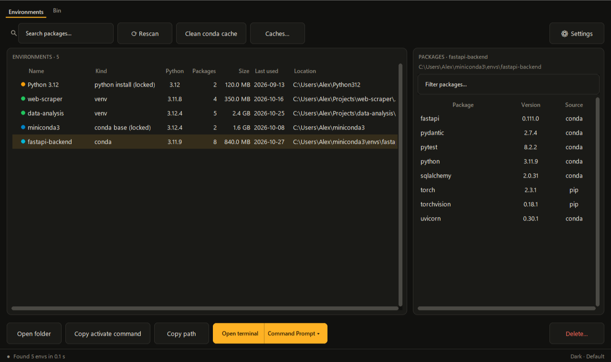

# Venv Discover

> Instant discovery, size calculation, package inspection, and safe cleanup of Python virtual environments across all your local drives.

Venv Discover is a fast, standalone desktop tool designed for developers and data scientists who want to reclaim disk space from forgotten virtual environments without accidentally breaking their projects or operating system.



## Download

Windows 10 and 11. Get `VenvDiscover-1.1.zip` from the [latest release](https://github.com/pullitall/Venv_discover/releases/latest), unzip it, and run `VenvDiscover.exe`. Nothing is installed.

- The exe isn't code-signed yet, so Windows SmartScreen may say "Windows protected your PC". Click **More info**, then **Run anyway**, or run it from source (below).
- `SHA256SUMS.txt` in the zip lists the checksum of every file. The zip also holds the user guide and the full source.

---

## Key Features

- **Automatic Multi-Drive Discovery:** Rapidly locates environments created by Conda, mamba, micromamba, Pixi, Hatch, PDM, Rye, pipx, Poetry, uv, and standard `venv` / `virtualenv`, alongside base Python installations across all local drives and config locations.
- **What Deleting Really Frees:** The Size column shows how much space deleting each environment frees, next to when it was last used. conda, mamba, pixi and uv hard-link package files from their caches, and those files stay on disk after a delete, so they aren't counted; envs that share files are marked `*`, and the details show the size on disk and the shared part.
- **Instant Package Inspector:** Reads installed package names, versions, and installer metadata directly from `.dist-info` and `conda-meta` files on disk without launching slow subprocesses.
- **14-Day Safety Bin:** Environments up to **1 GB** (1,073,741,824 bytes) are safely moved into a local 14-day recycle bin (`.venvdiscover-bin`) on that drive and can be restored with a single click. Large environments (> 1 GB) are guarded with explicit permanent deletion warnings.
- **Zero Third-Party Dependencies:** Written purely with Python's standard library (`tkinter`, `ctypes`, `winreg`, `json`, `tomllib`). No `pip install` required.
- **Native Offline Design:** Runs 100% locally with zero internet access, zero telemetry, and zero registry clutter.
- **Customizable Appearance:** Full support for Dark theme, Light theme, or automatic matching of Windows system preferences, accompanied by 4 distinct color palettes (Default, Night city, Calm glass, Bold editorial).
- **Package-Manager Caches:** Find and safely clean disk-consuming caches for uv, pip, poetry, and pipenv with one click.

---

## User Guide & Documentation

- **English User Guide:** [`docs/guide/how-to-use.en.html`](docs/guide/how-to-use.en.html) &mdash; Self-contained offline manual with screenshots and FAQs.

---

## Running from Source

Because Venv Discover relies strictly on the standard library, you can run it directly with any modern Python installation (Python 3.11+):

```powershell
python VenvDiscover.pyw
```

No virtual environment activation or `pip install -r requirements.txt` is needed.

---

## Command-Line & Automation (JSON mode)

Run with arguments, `VenvDiscover.exe` operates as a read-only command-line tool for scripts and AI agents without opening any GUI window:

```powershell
VenvDiscover.exe [--json] [--packages] [--sizes] [--search NAME[==VER]] [--known-only] [--paths DIR ...] [--caches]
```

Or from source:
```powershell
python -m venvdiscover [--json] [--packages] [--sizes] ...
```

### Flags
- `--json`: Output environments as a single, structured JSON document (schema version 1) to `stdout`.
- `--packages`: Include installed package lists (`name`, `version`, `source`) for each environment.
- `--sizes`: Measure sizes and last-used dates (omitted by default for sub-second speed). `size` is the size on disk, `size_unique` what deleting frees (without files hard-linked from a package cache).
- `--search NAME[==VER]`: Return only environments containing the given package (supports PEP 503 normalization and optional exact version, e.g. `numpy==1.26.4`).
- `--known-only`: Skip full drive scanning and inspect only registered environment locations (completes in ~1 s).
- `--paths DIR ...`: Restrict directory scanning strictly to designated folders.
- `--caches`: Include package-manager cache locations (uv, poetry, pipenv, pip).
- `--help`: Print usage and options to `stdout`.

### Exit Codes
- `0`: Success (output written to `stdout`).
- `2`: Bad arguments or invalid command-line options.
- `3`: Scan error or unexpected failure (error details written to `stderr`).
- `4`: No output stream available (e.g. `sys.stdout` is `None` when run directly in a terminal without pipes or redirection).

> **Note for Terminal Users:** Because `VenvDiscover.exe` is built as a windowless application to prevent console window flashing in everyday use, running it bare in a terminal returns immediately. Run it from a script, pipe it (`VenvDiscover.exe --json | ConvertFrom-Json` or `| Out-Host`), or redirect output to a file (`VenvDiscover.exe --json > envs.json`).

---

## Running the Test Suite

The test suite includes extensive unit, UI, and integration coverage. All tests run on an isolated hidden Windows desktop (`WinSta0\...`), guaranteeing zero window flashing, zero focus stealing, and zero interference with your desktop:

```powershell
python scripts/run_tests.py --workers 3
```

---

## Building the Standalone Executable

Run `python scripts/build_release.py` (Python 3.11). It runs the tests, builds `VenvDiscover.exe` with PyInstaller in its own `.build-venv`, smoke-tests it on a hidden desktop, and writes `dist/VenvDiscover-<version>.zip` with the exe, the user guide and the source.

Every push is tested and built by GitHub Actions ([`.github/workflows/build.yml`](.github/workflows/build.yml)). From 1.2 on, release zips come straight from that workflow with a build-provenance attestation, so you can check that a zip was built from this repository:

```powershell
gh attestation verify VenvDiscover-1.2.zip --repo pullitall/Venv_discover
```

---

## Status and Limitations

- Windows only.
- Support for pixi, mamba/micromamba, Hatch, PDM and Rye follows those tools' source code, but hasn't been tried on real installs yet. If Venv Discover misses or misreads an environment, please [open an issue](https://github.com/pullitall/Venv_discover/issues) with the folder layout.
- Environments over 1 GB can only be deleted permanently. Check the list in the confirmation window before you click **Delete**.

---

## License

MIT. See [`LICENSE`](LICENSE).
